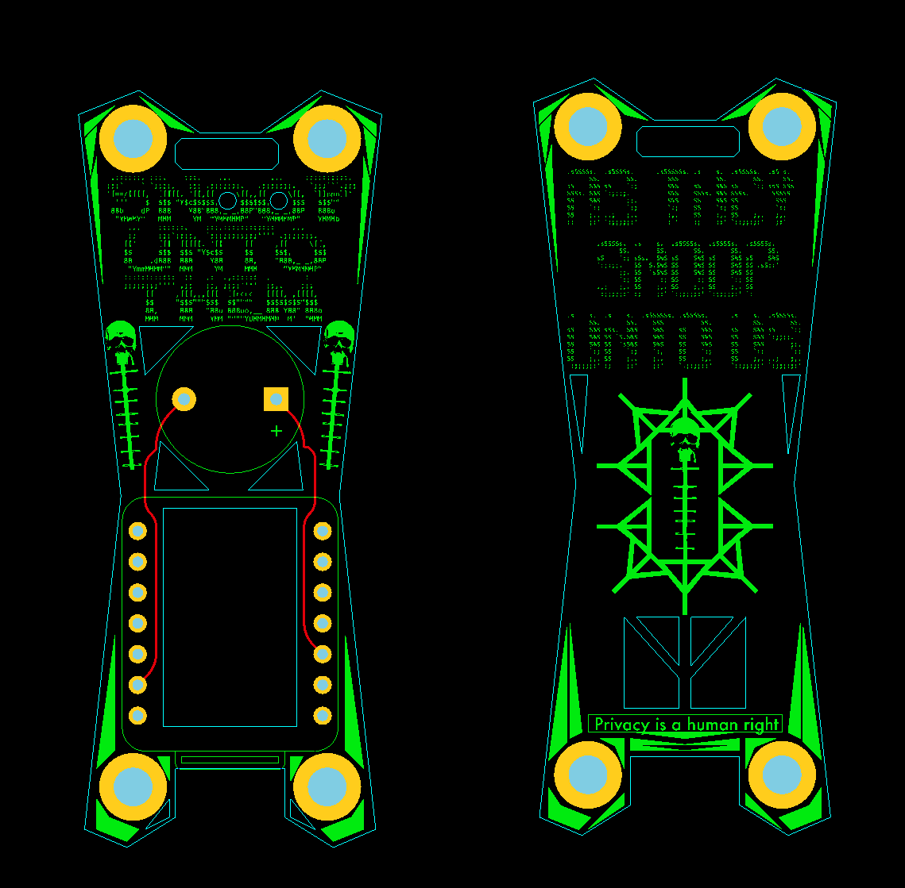

# OUI-SPY - Detector (Dual Domain Edition)



Professional dual-domain (BLE + WiFi) scanning system that detects specific devices by MAC address or OUI with audio feedback. BLE advertisements and 802.11 management frames (probe requests / beacons) are detected on the shared 2.4 GHz radio via time-sliced scanning.

## Flash from your browser

No Python, no PlatformIO, no drivers to install:

**https://colonelpanichacks.github.io/ouispy-detector/**

Chrome, Edge, or Opera on desktop. Plug in the XIAO ESP32-S3 with a USB-C data cable, click **Connect & Flash**, pick the serial port. It writes the full image (bootloader, partition table, boot selector and `src/detector.bin`), so a blank or bricked board comes up clean, and it always ships the latest firmware on `main`.

- **Erase or keep settings:** the flasher asks. Erase for a fresh install; keep to update a node without losing its filters, Wi-Fi, MQTT and mesh settings. A burn-in lock survives a reflash unless you erase.
- **Mesh fleets:** this build sends ESP-NOW at the long-range 250 kbps rate. Flash **every node in a mesh** with the same release so they all speak the same rate and protocol.

## Hardware

**OUI-SPY Board** - Available on [colonelpanic.tech](https://colonelpanic.tech)
- ESP32-S3 based detection system
- Integrated buzzer and power management
- Ready-to-use, no additional components required

**Alternative:** Standard ESP32-S3 with external buzzer on GPIO3

**Enhanced Version:** Same firmware, add NeoPixel LED for visual feedback
- Buzzer: GPIO3 (D2)
- NeoPixel: GPIO4 (D3)
- **Note:** One firmware supports both configurations automatically

## Quick Start

1. **Power on device** - Creates WiFi AP `snoopuntothem` (password: `astheysnoopuntous`)
2. **Connect and configure** - Navigate to `http://192.168.4.1`
3. **Add targets** - Enter OUI prefixes (`AA:BB:CC`), full MAC addresses, or click vendor presets in the OUI Database
4. **Save configuration** - Device automatically switches to scanning mode

## Features

### MQTT / Home Assistant Integration
- Publishes detections to any MQTT broker (Mosquitto, etc.)
- Auto-discovery: OUI Spy appears as a device in Home Assistant automatically
- Detection blips: sensor shows MAC on detection, returns to "idle" after 10 seconds of silence
- WiFi STA connection if alert is detected.
- Configurable broker, port, credentials, and topic from the web UI
- No external libraries required (raw MQTT over TCP)
- Clean socket teardown: MQTT disconnect packet sent before STA is dropped, so the broker sees an orderly disconnect rather than a timed-out session

### Node Mesh (ESP-NOW Long Range)
- **Mesh-style node linking:** any number of OUI-SPY nodes form a flood mesh over ESP-NOW with the LR protocol enabled — no access point, no pairing. Every node repeats what it hears: a detection only needs a path, not direct reach to home
- **Two roles, same firmware:** each node is configured as **home** (aggregates the mesh and publishes to MQTT) or **remote** (uplink is the mesh; MQTT ignored). Any node can hold either role
- **Remote fleet management from the home portal:** live node roster, **mute/unmute all remotes** (buzzer, optionally LED — instant and persisted), **push the current filter list to every remote** (chunked transfer with CRC32; remotes save and reboot into the new list), and **reboot all remotes**, with live ack counts
- **Unified alerts:** mesh-originated detections beep/flash on every node, appear in device history with a `[mesh xxxx]` provenance tag, and publish through the home node's MQTT exactly like local detections
- **Presence:** nodes announce in short bursts every 1.5 s; joins/leaves are logged on serial and counted in the heartbeat line
- **Fleet key (optional):** a shared secret signs every fleet command (HMAC-SHA256 with a replay counter); keyed nodes ignore unsigned, wrongly signed and replayed commands

### Detection System
- **Dual-domain time-slicing:** The 2.4 GHz radio alternates between WiFi promiscuous sweeps (channels 11→1, 200 ms dwell, ~2.2 s) and BLE active scans (~2.2 s). Each domain runs only if at least one filter of that type is configured; with no filters at all the device idles.
- **WiFi promiscuous detection:** Matches the source OUI of 802.11 management frames — probe requests (subtype 0x04) and beacons (subtype 0x08) — with per-(MAC, frame type) 30 s de-duplication.
- **Fast-path OUI pre-check:** A small lookup table of target OUIs is maintained in RAM and rebuilt whenever WiFi filters change. The promiscuous callback drops non-matching frames before doing the full filter comparison, keeping the ISR path lightweight.
- **Ring-buffer detection queue:** Both the WiFi promiscuous ISR and the BLE callback enqueue detections into a fixed ring. The main loop drains it, handles audio/visual alerts, publishes to MQTT, and writes session data. This prevents back-to-back hits from different devices from overwriting each other.
- **One-click vendor signatures:** Add every known signal for a device family from the OUI Database — OUIs, company IDs, service UUIDs, and WiFi probe/beacon signatures in a single click.
- OUI filtering for device manufacturers (BLE and WiFi)
- Full MAC address matching
- Persistent configuration storage in NVS (survives reboots)

### Audio & Visual Feedback
- **Audio:** 2 ascending beeps (ready), 3 beeps (new detection or 30 s re-alert), 2 beeps (3 s re-alert)
- **Visual:** Pink breathing LED during scanning, blue → pink → purple flash on detection
- **Synchronized:** LED flashes match beep timing
- Smart cooldown prevents spam
- All alerts are driven from the main loop, not from ISR context, so the radio stacks stay stable

### Privacy
- MAC address randomization on boot — both the WiFi MAC and the BLE-origin MAC (the BT DMAC is derived from the same base MAC, so one `esp_wifi_set_mac()` call randomizes both). Disabled when MQTT is enabled so the DHCP lease stays stable.
- Stealth mode operation
- No traceable hardware fingerprints

### Device Management
- **Device Aliasing:** Assign custom names to detected devices via the web portal
- **Persistent History:** All detected devices saved to NVS (up to 100 devices)
- **Automatic Sync:** Device list updates across reboots
- **Clear History:** Remove all stored device records
### Burn In Settings
- **Permanent Lock:** Lock configuration and bypass setup on boot
- **Instant Scanning:** Device boots directly into scanning mode
- **Protected Settings:** All filters, aliases, and preferences preserved
- **Reversible:** Hold the BOOT button 1.5 seconds to clear the lock and reboot into config mode


## Installation

### Prerequisites

Install PlatformIO in a Python virtual environment using the pinned requirements:

```bash
python3 -m venv .venv
source .venv/bin/activate
pip install -r requirements.txt
```

This gives you `pio` (PlatformIO CLI) with a known-good version of the toolchain.

### Build and Flash

From the repository root:

```bash
source .venv/bin/activate
pio run -e seeed_xiao_esp32s3 -t upload
```

### Open Serial Monitor

```bash
pio device monitor -b 115200
```

The firmware expects the XIAO ESP32-S3's USB-CDC serial port to enumerate as a `/dev/ttyACM*` device on Linux. If it doesn't appear, hold the BOOT button while plugging in to force download mode, then flash again.

### Dependencies

Defined in `platformio.ini`; fetched automatically by PlatformIO on first build:

- NimBLE-Arduino ^1.4.0 (BLE scanning)
- ESP Async WebServer ^3.0.6 (config portal)
- Adafruit NeoPixel ^1.12.0 (LED)
- ArduinoJson ^6.21.0 (session persistence)
- Arduino core 3.3.12 / ESP-IDF v5.5.5 (pinned in `platform_packages` for promiscuous-mode buffer support)

## Configuration

### Web Portal

Access via `http://192.168.4.1` after connecting to the `snoopuntothem` AP.

**Filter entry:** Type an OUI prefix (`AA:BB:CC`) or full MAC (`AA:BB:CC:12:34:56`) into the filter input, toggle the BLE and/or WiFi badges to select domains, and press **Add Filter**. The row appears with domain badges that can be toggled by clicking them; saving writes the list to NVS.

**Vendor presets:** Below the filter list is the OUI Database — a browsable set of known surveillance-hardware vendors. Each card shows the vendor's BLE signatures (OUI prefixes, and where applicable company IDs / service UUIDs / name patterns) plus WiFi probe/beacon signatures. Click **+ Add** to install all signatures for that vendor in one go. Presets merge into the same unified filter list as manual entries — the row shows the vendor label and the domain badges indicate which radios the signature listens on.

Saved filters persist across reboots. After a reboot into config mode the filter list renders exactly as it was saved, including domain badges.

### Filter Types

Eight signature classes across two domains, all rendered as rows in the unified filter list:

| Type | Domain | Matches on | Example |
|---|---|---|---|
| **OUI** | BLE | First 3 bytes of the advertising MAC | `00:25:DF` |
| **MAC** | BLE | Complete 6-byte address | `00:25:DF:12:34:56` |
| **CID** | BLE | BT SIG manufacturer company ID in advert payload | `0x034D` |
| **SVC** | BLE | 16-bit BLE service UUID | `0xFC81` |
| **NAME** | BLE | Case-insensitive substring of the device name | `Ray-Ban` |
| **META** | BLE | Composite: CID `0x0D53` + svc `0xFD5F` in same advert, or name `Ray-Ban`/`Wayfarer`/`Oakley Meta` | META / RAY-BAN preset |
| **PROBE** | WiFi | Probe request from a target OUI | `00:25:DF` |
| **BEACON** | WiFi | Beacon frame from a target OUI | `00:25:DF` |

### OUI Database

The database is maintained in two source files: [`BLEOUIs.md`](BLEOUIs.md) (BLE signatures) and [`WiFiOUIs.md`](WiFiOUIs.md) (WiFi probe/beacon signatures). The sync scripts [`sync-oui-list.py`](sync-oui-list.py) and [`sync-wifi-oui-list.py`](sync-wifi-oui-list.py) regenerate the OUI Database section of the HTML between the `OUI_DB_START`/`OUI_DB_END` markers in `src/main.cpp`.

Run from the repo root after editing either `.md` file:

```bash
source .venv/bin/activate
python sync-oui-list.py
python sync-wifi-oui-list.py
```

### NeoPixel Wiring (Optional Enhancement)

```
ESP32-S3 Xiao    →    NeoPixel
─────────────────────────────────
GPIO4 (D3)       →    Data Input (DIN)
3.3V             →    VCC (Power)
GND              →    GND (Ground)
```

- **Normal scanning:** pink breathing animation
- **Detection:** blue → pink → purple flash, matched to the beep timing
- **Brightness:** 50/255 breathing, 200/255 detection flash

## MQTT Setup (Home Assistant)

1. On the config portal, scroll to **MQTT** and fill in your home WiFi SSID/password, broker IP/port, optional credentials, and topic.
2. Save. How the STA is used depends on the installed filters:
   - **BLE-only filters:** STA stays up the whole time — MQTT connects once and reports every detection live, exactly like single-domain firmware.
   - **BLE + WiFi filters:** promiscuous sweeps own the radio, so detections queue up and flush during the next BLE phase: STA comes up in a bounded report window, publishes everything queued, sends an MQTT DISCONNECT, and tearing down before the sweep resumes. Expected blind window per batch: ~2–12 s.
   - **WiFi-only filters:** no BLE phase ever opens a report window, so detections are **not** reported over MQTT (the device logs this on serial at scanning start). Use at least one BLE filter if you need reporting.
3. Home Assistant auto-registers an OUI Spy device via MQTT discovery — no `configuration.yaml` edits needed.
4. Payload example:

```json
{"mac":"aa:bb:cc:dd:ee:ff","alias":"my-device","rssi":-65,"type":"PROBE","match":"0025DF","desc":"AXON (WiFi)"}
```

## Node Mesh (ESP-NOW LR)

Link multiple OUI-SPY nodes so a detection heard by any node alerts everywhere and reports through one gateway.

1. On each node, open the config portal and scroll to **Node Mesh (ESP-NOW Long Range)**.
2. Enable the mesh, pick the role, and set the **same channel (1–11) on every node**.
   Optionally set the same **Fleet Key** on every node (see Security below).
3. On the **home node** also fill in **MQTT** — it is the mesh's gateway to your broker/Home Assistant.
4. Save. Every node now floods its detections; each relay extends the mesh one more hop.

**Roles**

- **Remote node:** detects normally (beeps, LED, history) and uplinks every detection over ESP-NOW LR instead of MQTT. Its MQTT settings are ignored while meshing.
- **Home node:** does everything a remote does, *plus* every mesh detection it hears — its own or relayed — is published to MQTT with the same JSON payload, now carrying a `[mesh xxxx]` suffix in `desc` naming the origin node's ID.

**How it works**

- Transport is ESP-NOW broadcast (vendor-specific action frames) on the mesh channel, with the LR protocol enabled on every node. Release builds (and the web flasher) send ESP-NOW at the LR PHY rate (`-DMESH_ESPNOW_LR_RATE=WIFI_PHY_RATE_LORA_250K` in `platformio.ini`) for more range; remove that flag to fall back to the driver's default 1 Mbps. It is fleet-wide: flash every node with the same setting.
- Flooding uses a 3-hop TTL and a 60 s (origin, seq) duplicate cache, so every packet is relayed at most once per node and loops die naturally.
- The mesh window is the BLE phase: the radio parks on the mesh channel there, so RX/TX works alongside BLE scanning. During WiFi sweeps the mesh goes quiet by design (the sweep owns the radio); TX still lands on the mesh channel because the broadcast peer is pinned there, so nothing is lost.
- A node with **no filters at all** but mesh enabled becomes a pure relay — drop one on a hill between two others and the mesh extends itself.

**Managing the fleet from the home node**

Open the config portal on the home node (it keeps the mesh up while the portal is open — its AP shares the mesh channel, so remotes in the field stay reachable). The **Mesh Management** panel shows the live roster and provides:

| Action | Behavior on remotes |
|---|---|
| **Mute / Unmute All Remotes** | Buzzer (and LED, if checked) disabled instantly, persisted across reboots |
| **Push Current Filters to Mesh** | Takes the filter list currently in the form, floods it (chunked, CRC32-verified); remotes write it to NVS and reboot into the new list (~3 s). Ack count shows confirmations |
| **Reboot All Remotes** | Remotes ack and reboot; they rejoin in a few seconds |

Acks are flooded like detections, so the ack count includes remotes beyond the home's direct reach. Only successful applies are counted. Filters pushed this way replace the remote's whole user-managed list; preset-only rows on the home are not pushed (remotes keep whatever presets they already carry — push the expanded rows you want installed).

**Serial provisioning console**

While the config portal is open, the USB serial accepts one-line provisioning commands — handy for headless fleet setup from a cable instead of a browser:

```
mesh 1 remote 6                          → enable mesh, role, channel (applies live)
meshkey <secret>                         → set the fleet key (8-63 chars; "meshkey -" clears), any mode
filter 0025DF 0 1 probe AXON body cam    → add filter: <oui> <ble> <wifi> <probe|beacon> [desc]
clearfilters                             → wipe the staged list
provisiondone                            → save everything + switch to scanning
burnin                                   → same as provisiondone, then lock config
                                         (boots straight to scanning forever;
                                          BOOT-hold at power-on to unlock)
```

Responses are `OK ...` / `ERR ...` per line. Filters staged this way persist like any saved config.

**Remote management console**

These work in **any mode**, including a burned-in home node in the field. `<target>` is a node's stable ID (e.g. `D4E5F6`) or `all`. A command for one node goes out addressed to that node, and the others ignore it.

```
status                                   → this node's settings + health as one RST {json} line
filters                                  → this node's filter list as one RFL {json} line
audio <0|1> <0|1>                        → this node: buzzer on/off, LED on/off (persisted)
ident [secs]                             → this node: beep + flash so you can find it (ignores mute)
reboot                                   → reboot this node
rstatus <target>                         → ask node(s) for their settings (RST lines come back)
rfilters <target>                        → ask node(s) for their filter lists (RFL lines come back)
raudio <target> <0|1> <0|1>              → set buzzer/LED on node(s)
rident <target> [secs]                   → make node(s) beep + flash
rpreset <target> <axon|meta|ipro|verkada> → add a vendor preset on node(s), which then reboot
rreboot <target>                         → reboot node(s)
mfbegin <target|self|all>                → start a filter-list upload (from a tool or script):
mfdata <hex>                             →   records in the MESH_CMD_FILTERS format, up to 96 bytes a line
mfend                                    →   validate and send it (self = write to this node)
```

Each accepted command prints `CMD {"op":..,"id":..,"target":..}`, and every ack from the fleet prints `ACK {"node":..,"id":..,"st":..}` (`st` 0 = applied, 1 = rejected, 2 = fleet key mismatch, 3 = replayed). Nodes on firmware older than this build answer the new commands with `st` 1. They still obey fleet-wide `raudio`/`rreboot` and filter pushes.

A pushed filter list is validated as a whole before the remote writes anything. A list it can't take is refused, and its existing filters stay intact.

**Serial output**

```
[MESH] ESP-NOW LR up: REMOTE node, channel 6, id 7A8B1C
[MESH] node 3F2E91 joined (home)
[MESH] audio changed by home (buzzer MUTED, LED on)
[MESH] 12 filters pushed by home — rebooting to apply
[MESH] link: 2 node(s) in roster
[HEARTBEAT] phase=1 ch=6 dev=12 mesh=2
```

**Link indicator**

With the mesh enabled, the onboard orange LED is a live link heartbeat: **solid ON while at least one other node is in the roster, OFF when the node is alone**. Detection blinks override it for the duration of the beep pattern, then the steady state comes back. The LED toggle in Audio & Visual settings governs it (mute everything = dark node), and in config mode the serial log adds a `[MESH] link: N node(s)` line every 10 s.

**Notes & limits**

- Requires ESP32-S3 (LR mode is not available on the original ESP32).
- Mesh identity is the node's current WiFi MAC, which is randomized per boot unless MQTT is enabled — after a reboot the roster shows the node under a new ID. Detections are unaffected.
- Fire-and-forget transport: a detection burst may drop an occasional mesh packet; the 3 s / 30 s re-alert timers re-transmit on the next cycle anyway.
- In config mode only the **home** node keeps the mesh up (its portal AP shares the mesh channel); a remote in config mode is unreachable until it returns to scanning.
- **Security:** mesh packets are not encrypted, so detections can be read by anyone in range. Without a fleet key, any node on the channel can mute, reboot, re-channel or re-filter your remotes. With a fleet key set on every node, commands are signed (HMAC-SHA256) and carry a counter: keyed nodes refuse unsigned commands, wrong signatures and replays. Setting a new key resets the counters, so if the home node's flash is wiped, re-enter the key on the remotes too. Nodes without a key refuse signed commands, so set the key on the whole fleet together.
- **Upgrade the fleet together:** the management protocol is v2; nodes running the first mesh build (v1) and current nodes can't interoperate. Flash all nodes in one session.

## Operation

### Startup Sequence

1. Load MQTT config; randomize MAC unless MQTT is enabled
2. Load saved filters, aliases, and device history from NVS
3. If burned in, boot straight to scanning mode
4. Otherwise start config mode (AP + web portal) and stay there until the user saves
5. If both WiFi and BLE filters exist, alternate radio phases; if only one domain has filters, run just that domain; if none, idle

### Detection Logic

- **Time-sliced dual-domain scanning:** the shared 2.4 GHz radio alternates between a WiFi promiscuous sweep (channels 11→1, 200 ms dwell, ~2.2 s) and a BLE active scan (2 s), WiFi first.
- **Domain skip logic:** no BLE filters → BLE phases skipped; no WiFi filters → WiFi phases skipped; neither → idle.
- **WiFi matching:** the promiscuous callback drops every non-management frame and every management frame whose source OUI is not in the fast-path table, before spending any cycles on the full filter match.
- **BLE matching:** real-time OUI/MAC/CID/UUID/name matching against advertisements in the NimBLE callback.
- **Ring-buffer handoff:** both producer callbacks push a fixed-size `DetectionEntry` into a ring; the main loop drains it and drives the buzzer, LED, and MQTT publish. Beeps and flash are *not* called from the ISR context.
- **De-duplication:** per (MAC, frame type) 30 s cooldown suppresses beacon-flood re-alerts; 3 s re-alert timer for repeat sightings.
- **STA report:** with WiFi filters installed, detections that land during sweeps queue as JSON payloads and flush in one bounded report window during the next BLE phase (STA up → publish all → MQTT DISCONNECT → STA down → sweep resumes). BLE-only configs publish directly because STA never drops.

## Serial Output

```
=== OUI Spy Enhanced BLE Detector ===
Original MAC: d8:3b:da:45:aa:a0
Randomized MAC: a2:f3:91:7e:8c:45

Loading configuration...
Device aliases loaded from NVS (3 aliases)

=== STARTING SCANNING MODE ===
Configured Filters:
- D42DC5 (OUI): I-PRO body cam (BLE OUI)
- D42DC5 (PROBE): I-PRO body cam (WiFi probe)

>> Match found! <<
{"mac":"d4:2d:c5:ab:cd:ef","alias":"","rssi":-65,"type":"PROBE","match":"D42DC5","desc":"I-PRO body cam (WiFi probe)","node":"A1B2C3","dom":"wifi"}
```

`node` is the stable ID of the node whose radio made the detection, and `dom` is
`ble` or `wifi`. While scanning (and in config mode with the mesh on) the node also prints a `TLM {json}`
telemetry line every 5 seconds (identity, mesh counters and the live roster).

## Troubleshooting

- **No WiFi AP:** Wait a few seconds after power-on; if the device is burned in it skips config mode entirely (hold BOOT 1.5 s to unlock)
- **No web portal:** Ensure connected to `snoopuntothem`; disable mobile data if the phone keeps roaming off the AP
- **No audio:** Check `buzzerEnabled` was not previously cleared by an early firmware version — re-save the config to restore
- **No LED:** Check NeoPixel wiring (GPIO4, 3.3V, GND)
- **WiFi detections not firing:** Verify the source OUI is installed as a `PROBE` or `BEACON` filter; the WiFi fast-path table is built from those, so a bare BLE `OUI` filter does not enable WiFi matching
- **Can't unlock burned config:** Hold BOOT 1.5 s during power-on or while running; erase flash as a last resort (`pio run -e seeed_xiao_esp32s3 -t erase`)

## Technical Specifications

- **Platform:** ESP32-S3 (XIAO ESP32-S3 reference board)
- **Radio:** Shared 2.4 GHz radio, software coexistence enabled
- **Scan cycle:** ~4.2 s time-slice (2.2 s WiFi sweep + 2.0 s BLE scan)
- **WiFi sweep:** channels 11→1, 200 ms dwell per channel, management frames only
- **Range:** 10–30 m typical.
- **Storage:** NVS for filters/aliases/history
- **Device history:** Up to 100 devices persisted in NVS
- **Audio:** GPIO3 buzzer with LEDC PWM + bit-banged fallback
- **Visual:** GPIO4 NeoPixel

## OUI-SPY Firmware Ecosystem

OUI-SPY Detector is part of the OUI-SPY firmware family:

| Firmware | Description | Board |
|----------|-------------|-------|
| **[OUI-SPY Unified](https://github.com/colonelpanichacks/oui-spy-unified-blue)** | Multi-mode BLE + WiFi detector | ESP32-S3 / ESP32-C5 |
| **[OUI-SPY Detector](https://github.com/colonelpanichacks/ouispy-detector)** | Targeted dual-domain scanner with OUI filtering (this project) | ESP32-S3 |
| **[OUI-SPY Foxhunter](https://github.com/colonelpanichacks/ouispy-foxhunter)** | RSSI-based proximity tracker | ESP32-S3 |
| **[Flock You](https://github.com/colonelpanichacks/flock-you)** | Flock Safety / Raven surveillance detection | ESP32-S3 |
| **[AXEOFF](https://github.com/colonelpanichacks/axeoff)** | Headless Axon body cam / Taser detector — no UI, just beeps | ESP32-S3 |
| **[Sky-Spy](https://github.com/colonelpanichacks/Sky-Spy)** | Drone Remote ID detection | ESP32-S3 / ESP32-C5 |
| **[Remote-ID-Spoofer](https://github.com/colonelpanichacks/Remote-ID-Spoofer)** | WiFi Remote ID spoofer & simulator with swarm mode | ESP32-S3 |
| **[OUI-SPY UniPwn](https://github.com/colonelpanichacks/Oui-Spy-UniPwn)** | Unitree robot exploitation system | ESP32-S3 |

## Disclaimer

For research purposes only. Use at your own risk: you assume all responsibility for how you use it, and the authors accept no liability. Provided as is, with no warranty. Follow your local laws, and don't do anything illegal or stupid.

## License

Open source project. Modifications welcome.
