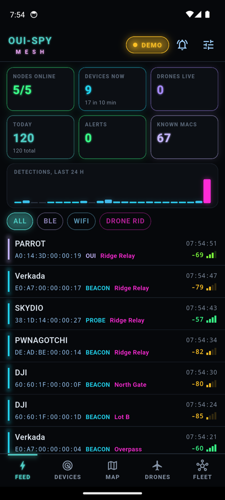
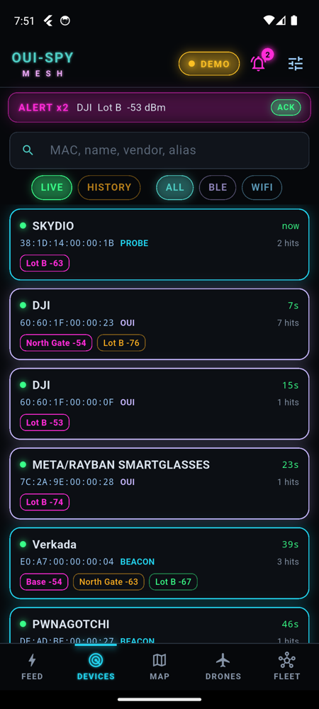
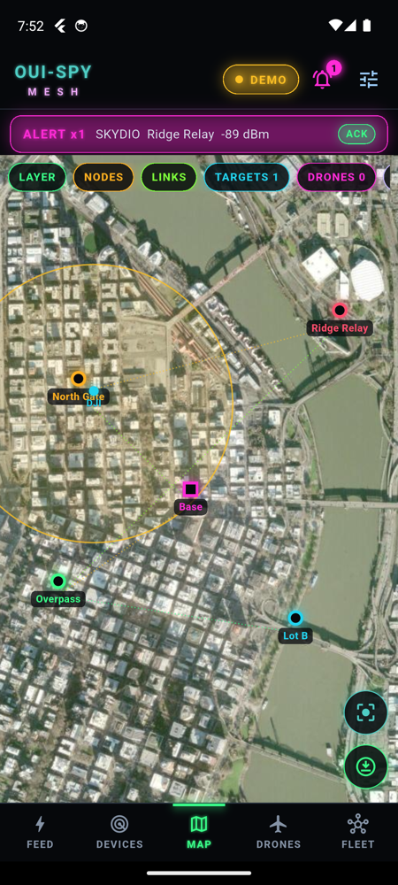
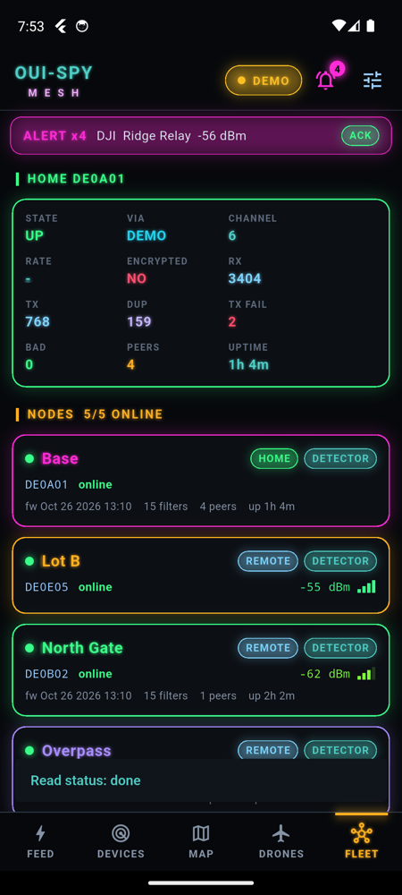
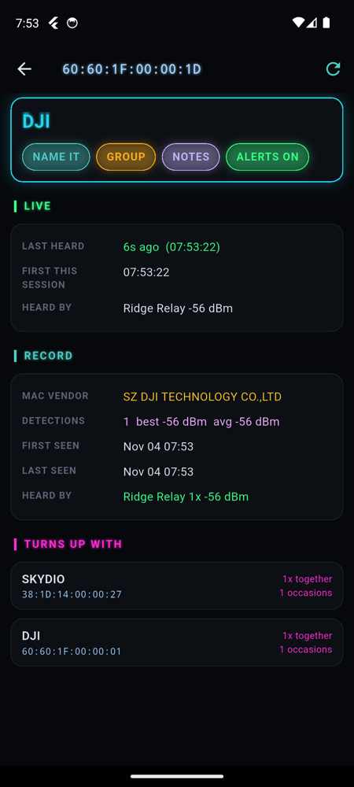
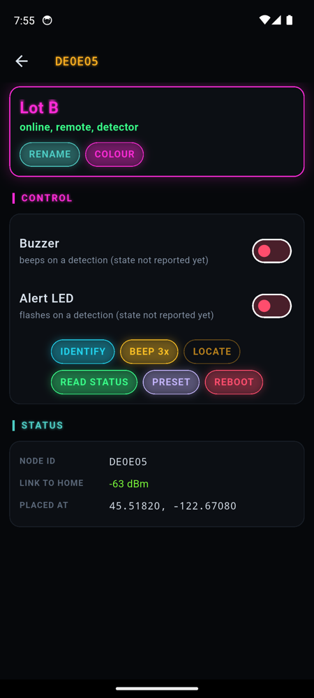
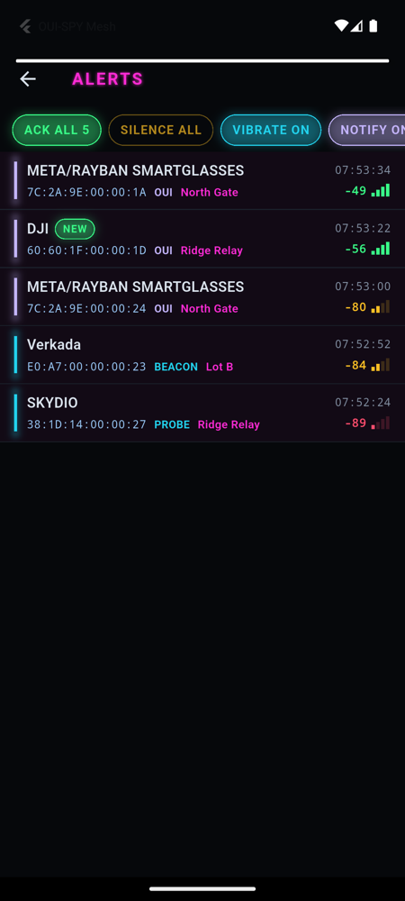
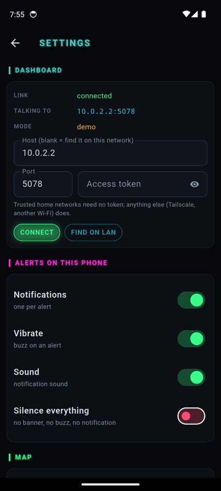

# OUI-SPY Mesh mobile app

The OUI-SPY Mesh dashboard on a phone: the Tab5 wall display's views and neon look, laid out for portrait touch screens. One Flutter codebase builds for Android and iOS.

It is a client of the home dashboard (`home-dashboard/`), exactly like the Tab5. It talks to nothing else: no accounts, no analytics, no outside map or tile servers.

<p>
 
 
</p>
<p>
 
 
</p>

(Screenshots are from the Android emulator against `ouispymesh.py --demo --demo-showcase`: synthetic data.)

## What it does

| Tab | What's on it |
|---|---|
| **FEED** | Overview KPIs: nodes online, devices now, drones live, today, alerts, known MACs. A 24 h detection histogram. The live detection feed, filtered ALL / BLE / WIFI / DRONE RID. |
| **DEVICES** | LIVE shows devices heard in the last 10 min, with every node that hears them and the triangulation fix. HISTORY searches everything the dashboard has stored. A device's detail page shows its full record, live signal, position, notes and the devices it turns up with. From there you can name it, group it, add notes, or mute its alerts. |
| **MAP** | Nodes with their mesh links, triangulated targets with error circles, drones with their tracks, pilots and pilot tracks, and the dashboard's pins and areas. Long-press drops a pin. Layer picker, fit-to-fleet, and **save this view offline**. |
| **DRONES** | Drones heard in a 1H / 4H / 8H / 24H / ALL window, or in a SPAN of dates. Live drones are listed on top. A drone's page has its map, every Remote ID field, the FAA make and model, a tag (friendly ... hostile), rename and notes, and its past flights, each of which can be drawn on the map. |
| **FLEET** | The home node's link counters, then every node with its state, link, firmware, filters and OTA. A node's page has controls for buzzer, alert LED, identify, beep, locate, read status, filter preset, rename, colour and reboot. It also shows the node's full status and its mesh neighbours. |
| **Alerts** (bell) | The same alert rule as the Tab5: a live detection of a device not heard for 10 minutes. ACK ALL, SILENCE ALL, vibrate and notification switches, swipe a row to mute that device. Each alert also gives a phone notification and a buzz. |
| **Settings** (status badge or the sliders icon) | The dashboard address, found on the LAN or typed in; the access token; how alerts reach the phone; muted devices; the offline tile cache; app update check. |

## How it connects (same as the Tab5)

- **Finding the dashboard.** Leave Host blank and the app looks for `_ouispy._tcp` over mDNS. Or type a host: a LAN IP, `name.local`, a Tailscale IP or MagicDNS name, optionally as `host:port`. The port defaults to 5077.
- **Auth.** Same as the Tab5:
  - Trusted home networks need nothing.
  - Anywhere else (Tailscale, another Wi-Fi), paste the token from `home-dashboard/access_token`.
  - The app sends it as the `ouispy_token` cookie on every request and on the socket.

  The token stays in the app's private storage.
- **Data.**
  - `GET /api/state?for=tab5` on every socket (re)connect and every 10 min. This is the Tab5's trimmed state. The full `/api/state` currently hangs (see AGENTS.md).
  - `/api/stats` every 30 s.
  - `/api/drones?<window>&track=0&rtrack=64` every minute and whenever the window changes.
  - `/api/devices/<mac>?flat=1`, `/api/devices?src=det&q=`, `/api/drones/<mac>/flights?compact=1` on demand.
- **Live.** Socket.IO (EIO 4, websocket) events: `fleet`, `det`, `sighting`, `dets_cleared`, `drone`, `tri`, `mac_aliases`, `groups`, `marks`, `node_event`, `node_filters`, `lost_node`, `job`.
- **Writes.** The same bodies the Tab5 posts:
  - `POST /api/devices/<mac>` takes `alias` / `notes`.
  - `POST /api/groups`.
  - `POST /api/drones/<mac>` takes `alias` / `tag` / `notes`.
  - `POST /api/nodes/<id>` takes `alias` / `color`.
  - `POST /api/nodes/<id>/cmd` takes `audio`, `identify`, `locate`, `status`, `preset` and `reboot`.
  - `POST /api/marks`.
- **Map tiles.** Tiles come only from the dashboard's `/tiles/<layer>/<z>/<x>/<y>` (it proxies and caches them on the Mac). Every tile the phone shows is also kept on the phone, so places you have looked at keep working away from home. The download button on the map saves the visible area, from the current zoom down 3 levels. Settings can turn off fetching altogether (saved tiles only).

## Build

The toolchain is the same as `~/Desktop/Projects/nexus_companion`: Flutter stable (3.41), with the JDK from Android Studio's JBR.

```bash
cd mobile-app
flutter pub get
flutter build apk --release        # build/app/outputs/flutter-apk/app-release.apk
flutter run                        # on a phone or emulator
```

iOS needs full Xcode and CocoaPods (this Mac has only the Command Line Tools):

```bash
flutter build ios --simulator      # or: flutter build ipa
```

`ios/Runner/Info.plist` already declares:
- local-network use;
- the `_ouispy._tcp` Bonjour service;
- plain-HTTP access, because the dashboard is `http://` on your own LAN or tailnet.

On the Android emulator the Mac is `10.0.2.2`. Put `10.0.2.2` in Host; mDNS does not cross the emulator's NAT.

The release APK is signed with the debug key for now, so it can be sideloaded. A real signing key is needed before any store.

## Updates

- **Phone app.** Settings asks the dashboard for `GET /api/mobile/latest`, expecting `{version, build, url, sha256}`. That endpoint does not exist yet, so the app says so. Once the dashboard serves the newest APK from there, Android can update over the air from your own Mac, with no store involved. iOS updates go through TestFlight or a rebuild.
- **Nodes.** Firmware OTA is the dashboard's job today (`fw_install` and friends). Phase 2 brings it to the phone.

## Layout

```
lib/
  main.dart            app, shell (top status bar, alert banner, bottom tabs)
  theme.dart           the Tab5 palette and glow widgets
  data/model.dart      live model (mirrors tab5-dashboard/src/model.*), alert rule
  data/dashboard.dart  REST + Socket.IO + mDNS; FeedSource interface for phase 2
  data/tiles.dart      dashboard tile provider + on-phone tile cache + area prefetch
  data/alerts.dart     notifications + vibration
  data/settings.dart   preferences
  views/               feed, devices, device detail, map, drones, fleet, alerts, settings
docs/PHASE2.md         talking to a node with no dashboard (USB OTG / BLE), the phone as
                       home node, flashing, board settings, Unified Blue
```
